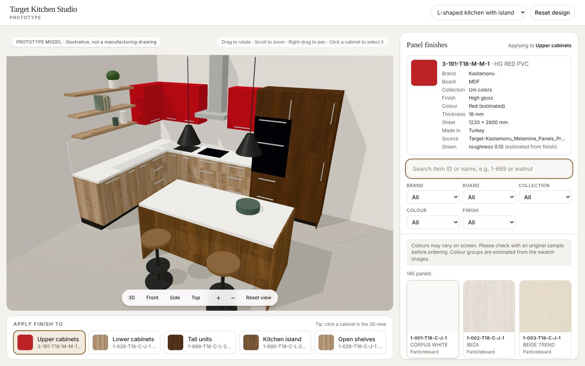

# Target Kitchen Studio (prototype)

A browser-based 3D kitchen visualiser for decorative wood panels. Pick a cabinet region, pick a panel, and the 3D kitchen updates live.

> **Data.** By default the app serves the real **Kastamonu** panels imported from `Target-Kastamonu_Melamine_Panels_Profile_2026.pdf` (145 Item IDs). Only what the PDF prints is used: Item ID, decor name, board, collection, finish (from the name prefix), sheet size, origin and swatch image. Colour groups and sheen are estimates and are labelled as estimates in the UI. No prices, stock or texture scale are invented. The separate `DEMO-…` catalogue is synthetic and is kept for testing. The kitchens are illustrative prototypes, not manufacturing drawings. No official Target branding is used.



## What works today

- A real WebGL 3D kitchen (Babylon.js), built from geometry: cabinet carcasses, doors, drawers, handles, plinths, worktops, splashback, hob, sink, hood, oven, island with waterfall ends, open shelves, stools and pendants.
- Two layouts from a model registry: **L-shaped with island** (5 regions) and **Straight** (4 regions).
- Separate material regions: upper cabinets, lower cabinets, tall units, kitchen island, open shelves. Changing a panel only changes the selected region.
- Select a region from the cards under the viewport or by clicking a cabinet in 3D.
- Live material switching with:
  - 12 tileable procedural textures (woodgrain, stone, textile effect) and 8 plain colours, 21 DEMO products in all;
  - texture scale in real-world metres, so grain is not stretched across doors (see "Texture rules");
  - grain direction and rotation per product;
  - roughness from product data, or an estimate from the finish name that the UI labels as an estimate;
  - textures downloaded only when a panel is selected, cached, and released when unused;
  - a hatched "TEXTURE UNAVAILABLE" placeholder and a warning when a texture fails. Another panel is never silently substituted.
- Camera: drag to rotate, scroll or pinch to zoom, right-drag or two-finger drag to pan, arrow keys when the canvas is focused, zoom buttons, reset, and Front / Side / Top / 3D views.
- Searchable catalogue (Item ID with or without dashes, decor name, collection, colour, finish, brand, board), brand/board/collection/colour/finish filters, and server-side paging from `/api/catalogue`. Tested with 600 records.
- PDF importer for brand catalogues laid out like the Kastamonu profile (see "Importing a brand PDF").
- Responsive layout for desktop, tablet and phone.
- Render-on-demand: the GPU stops drawing about 1.5 s after the last interaction.

Not built yet, on purpose (deferred by the project owner): saved designs, compare, share links, quotation requests, admin screens. No buttons for these exist in the UI.

## Run it locally

Requires Node.js 20.9 or newer. Everything used is free and open source.

```bash
npm install
npm run dev          # http://localhost:3000 (development)
# or
npm run build && npm start   # production build
```

## Tests

```bash
npm test             # unit tests (Node's built-in test runner)
npm run build && npm start   # in one terminal
npm run test:e2e:brands   # browser checks on the real brand data (default server)
CATALOGUE_FILE=data/demo-catalogue.json npm start   # demo data, then:
npm run test:e2e     # browser checks against the DEMO catalogue (set BASE_URL to change)
```

The browser checks need Playwright's Chromium (`npx playwright install chromium` once). Screenshots and `results.json` go to `e2e-screenshots/`.

Latest results (24 Oct 2026, headless Chromium with software WebGL):

| Check | Result |
| --- | --- |
| Browser checks, real Kastamonu data (145 panels load, real starting codes, only 2 textures downloaded at start, search 1-669 / walnut / MDF filter, woodgrain and MDF gloss on two regions, details show PDF facts and labelled estimates, phone layout) | 8/8 pass |
| Browser checks, DEMO catalogue | 20/20 pass |
| Unit tests: catalogue validation, CSV import, 600-record query, material mapping, mesh-to-region mapping, UV projection, brand files (codes unique, every image file exists, every product traceable to a PDF page) | 17/17 pass |
| T1 3D kitchen renders (142 meshes, 5 regions) | pass |
| T2 rotate (drag and arrow keys), zoom (wheel and buttons), pan (right-drag), preset views, reset view | pass |
| T3 search by code and by name, empty state, category filter | pass |
| T4 panel changes only the selected region (checked in the scene graph and by canvas pixels) | pass |
| T5 second region keeps the first region's panel | pass |
| T6 region summary shows the right codes | pass |
| T10 missing texture shows a warning and a placeholder, scene keeps working | pass |
| T12 phone 390×844: no horizontal scroll, tap select, one-finger touch rotate | pass |
| T14 every product is DEMO-coded and the disclaimer is shown | pass |
| Click a cabinet in 3D selects its region; reset design; switching layouts; no page errors | pass |

Not verified: real phones and tablets with GPUs (only emulated touch in Chromium), Safari and Firefox, and frame rate on real hardware. In software rendering a frame took about 2 to 4 ms; the 3D engine bundle is about 290 KB gzipped and loads after the page.

## Project structure

```
data/                      demo catalogue (JSON), CSV template
data/brands/               imported real brand catalogues (one JSON per brand)
public/brands/<brand>/     textures and thumbnails extracted from the brand PDF
public/demo-assets/        generated DEMO textures, thumbnails, model previews
docs/imports/              import report and product list per brand
scripts/
  generate-demo-textures.mjs   procedural texture generator (npm run textures:generate)
  catalogue-cli.ts             validate / import / stress-test catalogues
  import-brand-pdf.mjs         brand PDF -> catalogue JSON, textures, thumbnails, report
  e2e.mjs                      browser acceptance checks (DEMO data)
  e2e-brands.mjs               browser checks on real brand data
src/
  app/                     Next.js pages and the /api/catalogue route
  components/              Studio, Viewport, MaterialPanel, RegionBar, Swatch
  lib/catalogue/           product schema (zod), validation, CSV parser, search/paging
  lib/materials/           product -> material settings (pure, unit-tested)
  lib/models/              region ids, kitchen model registry, mesh-to-region mapping
  lib/scene/               Babylon.js: viewer, procedural kitchens, texture cache, material service, UVs
  lib/server/              file-backed catalogue repository
tests/unit/                unit tests
```

## Importing a brand PDF

```bash
npm run catalogue:import-pdf -- "Target-Kastamonu_Melamine_Panels_Profile_2026.pdf" --brand Kastamonu
```

This writes `data/brands/<brand>.json`, `public/brands/<brand>/textures|thumbs/`, and `docs/imports/<brand>-report.md` plus a CSV. Restart the server and the brand appears in the Brand filter. The importer:

- reads each decor card (name, Item ID lines, swatch) and cross-checks it against the PDF's quick order list (board, collection, sheet size, origin, page);
- uses the swatch embedded in the PDF at its original resolution, never a substitute;
- stores plain colours (uni collections with an even swatch) as a measured colour instead of a texture;
- detects grain direction and rotates the texture so grain runs up the image;
- reports low resolution, non-tiling swatches, unclear grain, names that disagree with the swatch colour, missing finishes and duplicates.

It expects the same layout as the Kastamonu profile (Item IDs like `1-026-T18-C-J-1`, a swatch above each decor name, a quick order list table). A PDF in another layout will report errors rather than guess.

Swatches in the Kastamonu PDF are 520 × 520 px and most do not tile, so repeats can show seams up close. High-resolution seamless scans from the supplier can be dropped into `public/brands/kastamonu/textures/` with the same file names.

## Adding real panel data from a spreadsheet

1. Fill in `data/catalogue-template.csv` (one row per panel), or supply JSON in the same shape as `data/demo-catalogue.json`. Leave unknown specifications blank: optional fields stay empty and are never invented.
2. Put texture and thumbnail images under `public/` (JPG, PNG or WebP) and reference them as `/textures/CODE.jpg`, or use `https://` URLs.
3. Validate and import:
   ```bash
   npm run catalogue:validate -- my-panels.csv
   npm run catalogue:import -- my-panels.csv --out data/catalogue.json --check-files
   ```
   The validator rejects missing or duplicate codes, duplicate ids, bad URLs and unsupported image formats, and warns about missing textures, scale or grain direction.
4. Put the file in `data/brands/` (all files there are served together), or set `CATALOGUE_FILE` (see `.env.example`) and restart. No application code changes are needed.

Field notes: `textureScale` is the real-world size in metres covered by one repeat of the texture; `grainDirection` is `vertical`, `horizontal` or `none`; `roughness` is 0 (mirror) to 1 (fully matt); set `isDemo` to `false` for genuine products. `stockStatus` should only be filled from a reliable live source.

To try a large catalogue: `npm run catalogue:stress -- 600` then `CATALOGUE_FILE=data/stress-catalogue.json npm start`.

## Texture rules

- Texture images must tile seamlessly and be authored with the grain running **up the image** (along its height).
- Cabinet UVs are generated in metres from the geometry ("box projection"), so `textureScale: 1` means one image covers 1 m × 1 m of panel on every door, whatever its size. Each door gets a small random offset so neighbouring doors don't show identical grain.
- Door and panel grain runs vertically; shelf grain runs along the shelf.
- 1024 × 1024 px is enough for a 1 m repeat on screen. Thumbnails are 192 × 192 px.

## Adding a kitchen model

Models live in `src/lib/models/registry.ts`. Each entry has an id, name, source (procedural builder or a `.glb` URL), preview image, region mapping rules, default panel per region and a default camera.

For a GLB file:

1. Put it in `public/models/` and add a registry entry with `source: { type: "gltf", url: "/models/kitchen.glb" }`.
2. Map its meshes to regions with `meshNames`, `meshNamePatterns` (regular expressions) or `materialNames`. Mesh names from 3D tools are often generic, so list the names you need and use the model's material names where they are cleaner. Meshes that match nothing keep their own material.
3. Choose `uvMode`: `"model"` keeps the file's UVs (they must be authored at 1 UV unit = 1 metre for `textureScale` to be correct); `"box-projection"` regenerates metre-based UVs, which suits flat doors and panels but not curved or profiled parts. Those need proper UV unwrapping in Blender or similar before import.

The GLB loading path is implemented but has not yet been exercised with a real model file, because none has been supplied.

## Deployment (free options only)

The app is a standard Next.js server app (pages plus one API route), with no database or paid services.

- **Netlify (free plan):** connect the GitHub repo; Netlify detects Next.js automatically. Build command `npm run build`.
- **Vercel (Hobby, free):** import the repo; no settings needed. Vercel's Hobby plan is limited to non-commercial use, so it fits a private demo but a public company site would need a different plan or host.
- **Any Node.js host or a small VPS:** `npm ci && npm run build && npm start` (port 3000, or set `PORT`).

`data/*.json` is bundled with the API route for serverless hosts (see `outputFileTracingIncludes` in `next.config.ts`).

## Known limitations and next steps

- Kastamonu textures come from 520 px catalogue swatches, and the real texture scale (size of one repeat) is not in the PDF; the preview assumes 1 m. Supplier scans and repeat sizes would fix both.
- Metals are approximated as grey non-metallic surfaces because no reflection environment is loaded; gloss shows as highlights rather than reflections.
- Next stages (deferred): saved designs and compare (local storage first), share links, quotation request with a review step, catalogue/admin tools, Supabase (free tier) storage for designs and enquiries.
