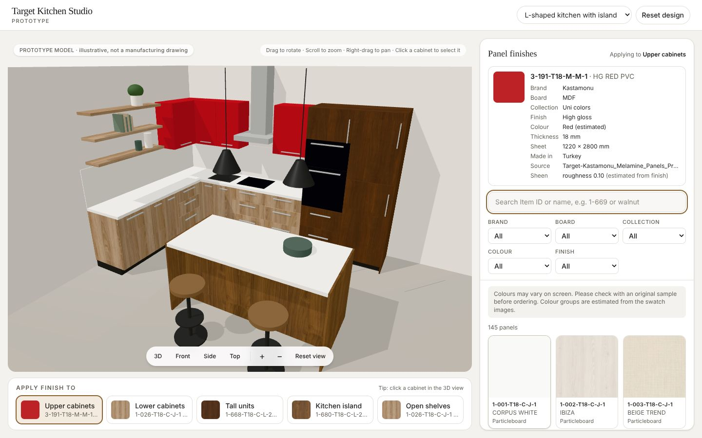
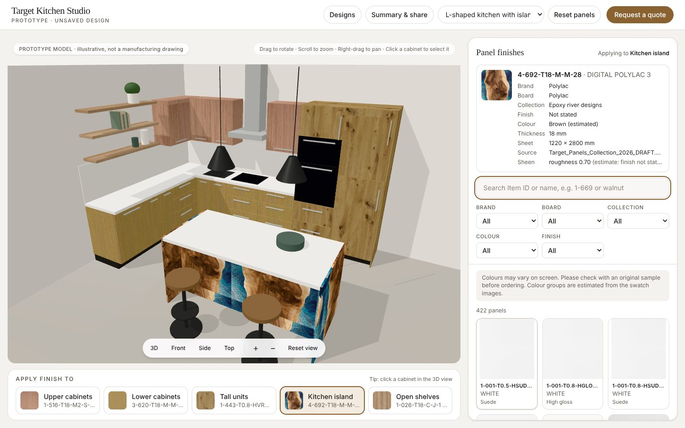
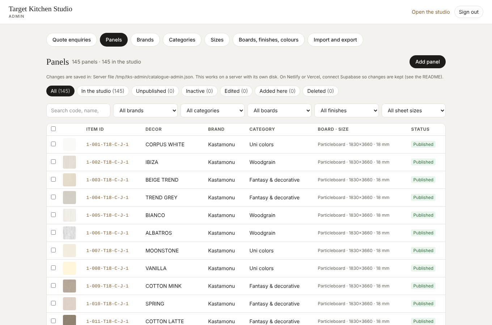

# Target Kitchen Studio (prototype)

A browser-based 3D kitchen visualiser for decorative wood panels. Pick a cabinet region, pick a panel, and the 3D kitchen updates live.

> **Data.** By default the app serves the real panels imported from `Target_Panels_Collection_2026_DRAFT.pdf`: **433 Item IDs from five brands** (Kastamonu 163, Greenlam 127, Glory 88, Target 49, Polylac 6), covering melamine faced particleboard and MDF, PVC/PET panels, HPL, compact laminate, curved panels and Digital Polylac. 422 are published; 11 are kept hidden until the missing information is supplied (see `docs/imports/collection-report.md`). Only what the PDF prints is used: Item ID, decor name, board, collection, finish (from the name prefix or the HPL surface heading), sheet size, origin and swatch image. Colour groups and sheen are estimates and are labelled as estimates in the UI. No prices, stock or texture scale are invented. The separate `DEMO-…` catalogue is synthetic and is kept for testing. The kitchens are illustrative prototypes, not manufacturing drawings. No official Target branding is used.





## What works today

- A real WebGL 3D kitchen (Babylon.js), built from geometry: cabinet carcasses, doors, drawers, handles, plinths, worktops, splashback, hob, sink, hood, oven, island with waterfall ends, open shelves, stools and pendants.
- Six layouts from a model registry: **L-shaped with island**, **Straight**, **U-shaped**, **Galley** (two parallel runs with a breakfast bar), **L-shaped with peninsula** and **Straight with island**. Each starts with its own real panel combination. All are illustrative prototypes, not measured designs.
- Separate material regions: upper cabinets, lower cabinets, tall units, kitchen island, open shelves. Changing a panel only changes the selected region.
- Select a region from the cards under the viewport or by clicking a cabinet in 3D.
- Live material switching with:
  - 12 tileable procedural textures (woodgrain, stone, textile effect) and 8 plain colours, 21 DEMO products in all;
  - texture scale in real-world metres, so grain is not stretched across doors (see "Texture rules");
  - grain direction and rotation per product;
  - roughness from product data, or an estimate from the finish name that the UI labels as an estimate;
  - textures downloaded only when a panel is selected, cached, and released when unused;
  - a hatched "TEXTURE UNAVAILABLE" placeholder and a warning when a texture fails. Another panel is never silently substituted.
- Camera: drag to rotate, scroll or pinch to zoom, right-drag or two-finger drag to pan, arrow keys when the canvas is focused, zoom buttons, reset, and Front / Side / Top / 3D views.
- Searchable catalogue (Item ID with or without dashes, decor name, collection, colour, finish, brand, board), brand/board/collection/colour/finish filters, and server-side paging from `/api/catalogue`. Tested with 600 records.
- PDF importers for the multi-brand Panels Collection and for single-brand profiles laid out like the Kastamonu one (see "Importing a brand PDF").
- Responsive layout for desktop, tablet and phone. On phones the page scrolls and the 3D view and region cards stay pinned at the top, so the panel list has the rest of the screen.
- Render-on-demand: the GPU stops drawing about 1.5 s after the last interaction.
- **Saved designs with variants** (Designs button): name a design, add variants (each a full set of panel choices, layout and camera view), switch between them, rename, delete. If a variant has unsaved changes, switching asks first. Designs are kept in the browser (see "Where data is stored").
- **Summary & share**: a product-code summary per region (Item ID, decor, brand, board, finish, sheet size), a side-by-side comparison of saved variants, copy as text, CSV download, print, and a share link that reopens the exact design on any device.
- **Request a quote**: a form (name, phone or email, optional company, area, preferred contact, notes, consent). The server re-checks every panel code against the catalogue, stores the enquiry and returns a reference such as `ENQ-20261024-VU9CAQ`. The success screen only appears after the server confirms the enquiry was saved; any failure shows an error and keeps the form filled in. No prices are shown.
- **Admin** (`/admin`, off unless `ADMIN_PASSWORD` is set): list enquiries with their panel codes, open the customer's design, set status (new, contacted, quote sent, closed), add internal notes, export CSV. **Editable catalogue**: add, edit, unpublish, delete and restore panels; manage brands, categories, sheet sizes, boards, finishes and colour groups; upload swatch and texture images; import and export spreadsheets (see "Editing the catalogue in the admin").

Not built yet: individual staff accounts and an audit trail of who changed what, automatic resizing of uploaded images, and 3D side-by-side comparison.

## Run it locally

Requires Node.js 20.9 or newer. Everything used is free and open source.

```bash
npm install
npm run dev          # http://localhost:3000 (development)
# or
npm run build && npm start   # production build
```

## Tests

```bash
npm test             # unit tests (Node's built-in test runner)
npm run build && npm start   # in one terminal
npm run test:e2e:brands   # browser checks on the real brand data (default server)
# designs, sharing, quotes and admin (server started with ADMIN_PASSWORD and DATA_DIR):
ADMIN_PASSWORD=some-long-test-password DATA_DIR=/tmp/tks-e2e npm start
E2E_DATA_DIR=/tmp/tks-e2e ADMIN_PASSWORD=some-long-test-password npm run test:e2e:stage3
CATALOGUE_FILE=data/demo-catalogue.json npm start   # demo data, then:
npm run test:e2e     # browser checks against the DEMO catalogue (set BASE_URL to change)
# quote emails with no writable disk (as on Netlify): see the comment at the top of scripts/e2e-quote-email.mjs
```

Independent QA run of all 14 acceptance criteria (needs the real-data server with `ADMIN_PASSWORD` and `DATA_DIR`, plus the 600-record stress server on port 3001):

```bash
ADMIN_PASSWORD=some-long-test-password DATA_DIR=/tmp/tks-qa npm start
CATALOGUE_FILE=data/stress-catalogue.json PORT=3001 DATA_DIR=/tmp/tks-stress npm start
QA_DATA_DIR=/tmp/tks-qa ADMIN_PASSWORD=some-long-test-password npm run test:qa
```

The QA report with every test, its result and the fixes made is in `docs/qa-report.md`.

The browser checks need Playwright's Chromium (`npx playwright install chromium` once). Screenshots and `results.json` go to `e2e-screenshots/`.

Latest results (24 Oct 2026, headless Chromium with software WebGL):

| Check | Result |
| --- | --- |
| Browser checks, real brand data (422 published panels load, real starting codes, only 2 textures downloaded at start, search 1-669 / walnut / MDF filter, woodgrain and PVC gloss on two regions, details show PDF facts and labelled estimates, Glory, Target, Greenlam HPL and Polylac panels each on their own region, phone layout; 5 Nov 2026) | 9/9 pass |
| Browser checks, designs/sharing/quotes/admin (save and reload a design, variants and the unsaved-changes prompt, summary and variant comparison, CSV, share link in a fresh browser with the same codes and camera, unknown code in a link reported and not substituted, quote validation, server error and network error never show success, stored enquiry has server-checked panel details, unknown codes and spam rejected, admin locked without sign-in, wrong password refused, password not in page scripts, status change saved, cross-site change refused, CSV export, import blocked on errors, clean import goes live and is removed, admin off without a password, phone layout) | 18/18 pass |
| Browser checks, all 6 layouts (each loads with its starting panels in every region, changing one region leaves the others alone, front/top/reset views, share link keeps the layout, phone layout), on real and on DEMO data | 22/22 pass on each |
| Browser checks, DEMO catalogue | 20/20 pass |
| Browser checks, quote email with no writable disk (as on Netlify): the request is emailed to info@targetqatar.com with the reference, all panel codes, a design link and escaped customer text, and success is shown; when the email service refuses and nothing is stored, the visitor sees an error and the WhatsApp button opens a chat with +974 7765 7373 holding the kitchen, codes and design link | 3/3 pass |
| Unit tests: catalogue, materials, mapping, UVs, brand files, designs and variants, share links, summary CSV safety, enquiry validation, file store (20 concurrent writes, unwritable disk fails loudly), Supabase store (against a stand-in server), rate limit, admin sessions and same-site checks, admin import, quotation email (content and escaping, Resend, SMTP against a stand-in mail server, stored-or-emailed rule), WhatsApp message and link | 40/40 pass |
| T1 3D kitchen renders (142 meshes, 5 regions) | pass |
| T2 rotate (drag and arrow keys), zoom (wheel and buttons), pan (right-drag), preset views, reset view | pass |
| T3 search by code and by name, empty state, category filter | pass |
| T4 panel changes only the selected region (checked in the scene graph and by canvas pixels) | pass |
| T5 second region keeps the first region's panel | pass |
| T6 region summary shows the right codes | pass |
| T10 missing texture shows a warning and a placeholder, scene keeps working | pass |
| T12 phone 390×844: no horizontal scroll, tap select, one-finger touch rotate | pass (QA, 24 Oct: the panel list was squashed to 24 px on phones; fixed, see `docs/qa-report.md`) |
| T14 every product is DEMO-coded and the disclaimer is shown | pass |
| Click a cabinet in 3D selects its region; reset design; switching layouts; no page errors | pass |

The Supabase path is tested only against a stand-in server in the unit tests, not a real Supabase project (none has been connected).

Not verified: real phones and tablets with GPUs (only emulated touch in Chromium), Safari and Firefox, and frame rate on real hardware. In software rendering a frame took about 2 to 4 ms; the 3D engine bundle is about 290 KB gzipped and loads after the page.

## Project structure

```
data/                      demo catalogue (JSON), CSV template
data/brands/               imported real brand catalogues (one JSON per brand)
public/brands/<brand>/     textures and thumbnails extracted from the brand PDF
public/demo-assets/        generated DEMO textures, thumbnails, model previews
docs/imports/              import report and product list per brand
scripts/
  generate-demo-textures.mjs   procedural texture generator (npm run textures:generate)
  catalogue-cli.ts             validate / import / stress-test catalogues
  import-brand-pdf.mjs         brand PDF -> catalogue JSON, textures, thumbnails, report
  e2e.mjs                      browser acceptance checks (DEMO data)
  e2e-brands.mjs               browser checks on real brand data
  e2e-stage3.mjs               browser checks for designs, sharing, quotes and admin
  e2e-layouts.mjs              browser checks for every kitchen layout (npm run test:e2e:layouts)
supabase/schema.sql        Supabase tables for enquiries and admin catalogue edits, and the image bucket
src/
  app/                     Next.js pages and the /api/catalogue route
  app/admin/               admin page; app/api/admin/* admin API, app/api/enquiries quote API
  components/              Studio, Viewport, MaterialPanel, RegionBar, Swatch, Designs/Summary/Quote dialogs, admin/
  lib/designs/             saved designs and variants, share links, summary (pure, unit-tested)
  lib/enquiries/           quotation form schema
  lib/catalogue/           product schema (zod), validation, CSV parser, search/paging
  lib/materials/           product -> material settings (pure, unit-tested)
  lib/models/              region ids, kitchen model registry, mesh-to-region mapping
  lib/scene/               Babylon.js: viewer, procedural kitchens, texture cache, material service, UVs
  lib/server/              catalogue repository and imports, enquiry store (file or Supabase), admin sign-in, rate limit
tests/unit/                unit tests
```

## Importing a brand PDF

The full multi-brand collection (the current data):

```bash
npm run catalogue:import-collection -- "Target_Panels_Collection_2026_DRAFT.pdf"
```

This writes one `data/brands/<brand>.json` per brand (brand from the quick order list's MADE IN / BRAND column), swatches under `public/brands/<brand>/`, and `docs/imports/collection-report.md` plus `collection-products.csv`. Product ids are `<brand>-<item id in lower case>`, so re-running it keeps ids (and saved designs, share links and admin edits) attached. On top of the rules below it:

- attaches every Item ID printed on a decor page to the swatch directly above it, so cards with several Item IDs (sheet sizes, HPL thicknesses, curved radii) share their own swatch;
- names swatch files by decor code, or by Item ID where one brand prints different pictures for the same decor code (e.g. an HPL decor in suede and in high gloss);
- reads HPL finishes from the surface heading above each card (Suede, High gloss, Veracious bark…) and checks the heading against the finish code in the Item ID;
- gives curved panels the texture of the flat panel with the same brand and decor code (the PDF shows curved panels only as 3D renders), and imports the ones without a flat panel as not published;
- keeps an Item ID that looks misprinted exactly as printed, but not published, and reports it.

A single-brand profile laid out like the Kastamonu one:

```bash
npm run catalogue:import-pdf -- "Target-Kastamonu_Melamine_Panels_Profile_2026.pdf" --brand Kastamonu
```

This writes `data/brands/<brand>.json`, `public/brands/<brand>/textures|thumbs/`, and `docs/imports/<brand>-report.md` plus a CSV. Restart the server and the brand appears in the Brand filter. The importer:

- reads each decor card (name, Item ID lines, swatch) and cross-checks it against the PDF's quick order list (board, collection, sheet size, origin, page);
- uses the swatch embedded in the PDF at its original resolution, never a substitute;
- stores plain colours (uni collections with an even swatch) as a measured colour instead of a texture;
- detects grain direction and rotates the texture so grain runs up the image;
- reports low resolution, non-tiling swatches, unclear grain, names that disagree with the swatch colour, missing finishes and duplicates.

It expects the same layout as the Kastamonu profile (Item IDs like `1-026-T18-C-J-1`, a swatch above each decor name, a quick order list table). A PDF in another layout will report errors rather than guess.

Swatches in the PDFs are 520 × 520 px (Polylac 454 × 632 px) and most do not tile, so repeats can show seams up close. High-resolution seamless scans from the supplier can be dropped into `public/brands/<brand>/textures/` with the same file names.

## Adding real panel data from a spreadsheet

1. Fill in `data/catalogue-template.csv` (one row per panel), or supply JSON in the same shape as `data/demo-catalogue.json`. Leave unknown specifications blank: optional fields stay empty and are never invented.
2. Put texture and thumbnail images under `public/` (JPG, PNG or WebP) and reference them as `/textures/CODE.jpg`, or use `https://` URLs.
3. Validate and import:
   ```bash
   npm run catalogue:validate -- my-panels.csv
   npm run catalogue:import -- my-panels.csv --out data/catalogue.json --check-files
   ```
   The validator rejects missing or duplicate codes, duplicate ids, bad URLs and unsupported image formats, and warns about missing textures, scale or grain direction.
4. Put the file in `data/brands/` (all files there are served together), or set `CATALOGUE_FILE` (see `.env.example`) and restart. No application code changes are needed.

Field notes: `textureScale` is the real-world size in metres covered by one repeat of the texture; `grainDirection` is `vertical`, `horizontal` or `none`; `roughness` is 0 (mirror) to 1 (fully matt); set `isDemo` to `false` for genuine products. `stockStatus` should only be filled from a reliable live source.

To try a large catalogue: `npm run catalogue:stress -- 600` then `CATALOGUE_FILE=data/stress-catalogue.json npm start`.

## Texture rules

- Texture images must tile seamlessly and be authored with the grain running **up the image** (along its height).
- Cabinet UVs are generated in metres from the geometry ("box projection"), so `textureScale: 1` means one image covers 1 m × 1 m of panel on every door, whatever its size. Each door gets a small random offset so neighbouring doors don't show identical grain.
- Door and panel grain runs vertically; shelf grain runs along the shelf.
- 1024 × 1024 px is enough for a 1 m repeat on screen. Thumbnails are 192 × 192 px.

## Adding a kitchen model

Models live in `src/lib/models/registry.ts`. Each entry has an id, name, source (procedural builder or a `.glb` URL), preview image, region mapping rules, default panel per region and a default camera.

For a GLB file:

1. Put it in `public/models/` and add a registry entry with `source: { type: "gltf", url: "/models/kitchen.glb" }`.
2. Map its meshes to regions with `meshNames`, `meshNamePatterns` (regular expressions) or `materialNames`. Mesh names from 3D tools are often generic, so list the names you need and use the model's material names where they are cleaner. Meshes that match nothing keep their own material.
3. Choose `uvMode`: `"model"` keeps the file's UVs (they must be authored at 1 UV unit = 1 metre for `textureScale` to be correct); `"box-projection"` regenerates metre-based UVs, which suits flat doors and panels but not curved or profiled parts. Those need proper UV unwrapping in Blender or similar before import.

The GLB loading path is implemented but has not yet been exercised with a real model file, because none has been supplied.

## Where data is stored

Everything uses free options. Nothing is sent to a paid service.

| Data | Where | Notes |
| --- | --- | --- |
| Saved designs and variants | The visitor's browser (localStorage) | Only on that browser and device; lost if site data is cleared. Use a share link to move a design. |
| Share links | Inside the link itself (`/?design=…`) | No server storage. The link holds the layout, panel codes and camera, not prices or personal data. |
| Quotation enquiries | `DATA_DIR/enquiries.json` on the server, or Supabase if `SUPABASE_URL` and `SUPABASE_SERVICE_ROLE_KEY` are set | The file option needs a server with a disk that is kept (any Node.js host or VPS). On Vercel or Netlify the disk is not kept, so set up Supabase (free tier, run `supabase/schema.sql`). Each request is also emailed (see below). A request counts as sent when it is stored or emailed; if neither works, the visitor is told it was not sent. Back up the file or database; contact details are personal data. |
| Catalogue edits and imports from admin | Supabase `catalogue_items` table, or `DATA_DIR/catalogue-admin.json` | Same disk rule as above. Brand PDF imports are part of the code (`data/brands/`) and are deployed with it; admin edits are applied on top. Older admin imports in `DATA_DIR/catalogue/*.json` are still read. |
| Images uploaded in admin | Supabase Storage bucket `catalogue-media`, or `DATA_DIR/media/` | |

### Quotation emails

Each quotation request is emailed to `info@targetqatar.com` (change with `QUOTE_EMAIL_TO`). It lists the contact details, every panel code chosen, the customer's notes and a link that reopens the design. Replying to the email replies to the customer. Pick one free option and set it in the server environment (on Netlify: Site configuration → Environment variables), then redeploy:

- **Resend (free tier, 100 emails a day):** create an account at resend.com using `info@targetqatar.com`, create an API key, and set `RESEND_API_KEY`. Until a domain is verified in Resend, it only delivers to the address the account was created with, sent from `onboarding@resend.dev`.
- **Company mailbox (SMTP):** set `SMTP_HOST`, `SMTP_PORT`, `SMTP_USER`, `SMTP_PASS` (and `SMTP_SECURE=true` for port 465) from your email provider. If both are set, SMTP is used.

### WhatsApp

The quote form also has **Send on WhatsApp**. It opens WhatsApp (app or web) with a message to Target's number (+974 7765 7373) listing the kitchen, every panel code, the design link and the customer's name and notes. The customer presses send in WhatsApp, so the studio cannot confirm it was sent. This uses a free wa.me link, needs no WhatsApp Business API account, and works without any email settings. To use another number, set `NEXT_PUBLIC_WHATSAPP_NUMBER` (digits with country code) before building.

Email keys and passwords stay on the server; none are in the browser code. Problems are written to the server log (Netlify: Logs → Functions).

## Admin

Set `ADMIN_PASSWORD` (at least 12 characters) in the server environment and open `/admin`.

- The password is checked on the server and never appears in the browser code. Sign-in sets an HttpOnly, SameSite=Strict cookie signed with HMAC, valid for 8 hours. Changing the password signs everyone out.
- Changes must come from the same site (Origin check). Sign-in is limited to 5 attempts per 15 minutes per address, and quote submissions to 5 per 10 minutes per address. These limits reset when the server restarts.
- This is basic protection: one shared password, no individual staff accounts, no audit trail of who changed what, no two-factor sign-in. Always serve the site over HTTPS. For more staff or stricter needs, add Supabase Auth (free tier) with individual logins.

## Editing the catalogue in the admin



Tabs in `/admin`:

| Tab | What you can do |
| --- | --- |
| Panels | Search and filter every panel (by brand, category, board, finish, size and status). Open a panel to edit any field: Item ID, decor name, brand, category, board, finish, colour group, sheet size, thumbnail, texture, plain colour, texture scale and rotation, grain, roughness, stock, notes, source. Add a new panel. Select many panels to publish, unpublish, delete, or change their brand, category, board, finish, colour group or size in one go. Deleted panels from a brand file can be restored; "Restore original" undoes every edit. |
| Brands, Categories, Sizes, Boards/finishes/colours | Add entries, edit them (renaming updates every panel that uses the entry), add a description and a logo or image, set the order of the studio's filter lists, and switch an entry off to hide all its panels from the studio. An entry that panels still use can only be deleted by moving those panels to another entry. Sheet sizes are offered as presets when adding or editing a panel. |
| Import and export | Import panels from CSV or JSON (checked first; if any row has an error nothing is imported; tick "Update panels that already exist" to overwrite by Item ID). Export every panel as CSV (the same columns as the import, so it can be edited in a spreadsheet and imported back) or a full JSON backup. |

How it is stored: the brand files in `data/brands/` stay exactly as deployed. The admin's changes are saved separately (one row per edited panel or list entry) and applied on top, so a new brand import can be deployed at any time without losing edits. If an added panel's Item ID later appears in a brand file, the brand file wins and the admin shows a warning. Changes show in the studio straight away on the same server and within about 10 seconds on other serverless instances.

| Data | Where |
| --- | --- |
| Catalogue changes | Supabase table `public.catalogue_items` when `SUPABASE_URL` and `SUPABASE_SERVICE_ROLE_KEY` are set, otherwise `DATA_DIR/catalogue-admin.json` |
| Uploaded images (JPG, PNG, WebP, up to 4 MB) | Supabase Storage public bucket `catalogue-media`, otherwise `DATA_DIR/media/` served at `/api/media/<file>` |

**On Netlify or Vercel, Supabase is required** for the admin to save changes, because their disks are not kept. Run `supabase/schema.sql` once in the Supabase SQL editor (it creates the `enquiries` and `catalogue_items` tables and the `catalogue-media` bucket), set `SUPABASE_URL` and `SUPABASE_SERVICE_ROLE_KEY` in the site's environment variables, and redeploy. Without it the admin says where changes would be saved and shows a clear error when a save fails; the studio keeps working from the brand files.

Browser checks for these screens: start a server with `ADMIN_PASSWORD` and `DATA_DIR`, then `ADMIN_PASSWORD=… npm run test:e2e:admin` (16 checks: edit, add, duplicate refused, bulk publish, delete and restore, brand rename/switch-off/order, category delete with move, sizes, image upload, CSV import and export, sign-in required, phone width).

## Deployment (free options only)

### Cloudflare Workers (free plan, recommended)

The site runs on Cloudflare Workers through [OpenNext](https://opennext.js.org/cloudflare). Brand files are bundled into the build (`scripts/bundle-catalogue.mjs` runs before every build), so no file system is needed. Catalogue edits, enquiries and uploaded images go to Supabase.

1. Create a free account at dash.cloudflare.com.
2. Workers & Pages → Create → Import a repository → connect GitHub and pick this repository. The Worker name must be `target-kitchen-studio` (as in `wrangler.jsonc`).
3. Build command: `npx opennextjs-cloudflare build`. Deploy command: `npx opennextjs-cloudflare deploy`.
4. Settings → Variables and Secrets (type Secret): `ADMIN_PASSWORD`, `SUPABASE_URL`, `SUPABASE_SERVICE_ROLE_KEY`, and `RESEND_API_KEY` for quote emails. Company SMTP does not work on Workers; use Resend.
5. Every push to `main` deploys automatically. The site is served at `target-kitchen-studio.<your-subdomain>.workers.dev`; add your own domain under Settings → Domains & Routes.

Locally: `npm run cf:preview` builds and runs the Worker at http://localhost:8787 (put variables in `.dev.vars`).

Free-plan limits: 100,000 requests a day and 10 ms of CPU time per request. Pages and images are static files and cost no CPU; the catalogue API takes a few milliseconds per request, more on the first request to a fresh server instance. If Cloudflare ever reports "exceeded resource limits" errors, the Workers Paid plan ($5 a month) lifts the CPU limit.

Tested with `wrangler dev` (Cloudflare's local runtime): real-data browser checks 9/9, admin checks 13/16 against a stand-in Supabase (the 3 misses are the image-upload step and the two steps after it, because the stand-in serves images over http; real Supabase uses https), quote email sent through Resend. Not yet tested on Cloudflare's servers.


The app is a standard Next.js server app (pages plus API routes). It needs no database. On a serverless host, quotation requests reach you by email; add the Supabase free tier if you also want them listed in `/admin`.

- **Netlify (free plan):** connect the GitHub repo; Netlify detects Next.js automatically. Build command `npm run build`.
- **Vercel (Hobby, free):** import the repo; no settings needed. Vercel's Hobby plan is limited to non-commercial use, so it fits a private demo but a public company site would need a different plan or host.
- **Any Node.js host or a small VPS:** `npm ci && npm run build && npm start` (port 3000, or set `PORT`). Enquiries and admin imports are saved in `DATA_DIR` on its disk; back that folder up.

On Netlify and Vercel, set up quotation emails (or Supabase) or the quote form cannot send (see "Where data is stored"), and connect Supabase for the admin's catalogue editing and image uploads, because their disks are not kept.

`data/*.json` is bundled with the API route for serverless hosts (see `outputFileTracingIncludes` in `next.config.ts`).

## Known limitations and next steps

- Textures come from 520 px catalogue swatches, and the real texture scale (size of one repeat) is not in the PDF; the preview assumes 1 m. Supplier scans and repeat sizes would fix both. Digital Polylac pictures show a whole printed sheet, so they repeat on large doors.
- Metals are approximated as grey non-metallic surfaces because no reflection environment is loaded; gloss shows as highlights rather than reflections.
- Saved designs are per browser. Saving designs to an account (so they follow a customer between devices) would need sign-in, for example Supabase Auth on the free tier.
- No email or WhatsApp notification for new enquiries yet.
