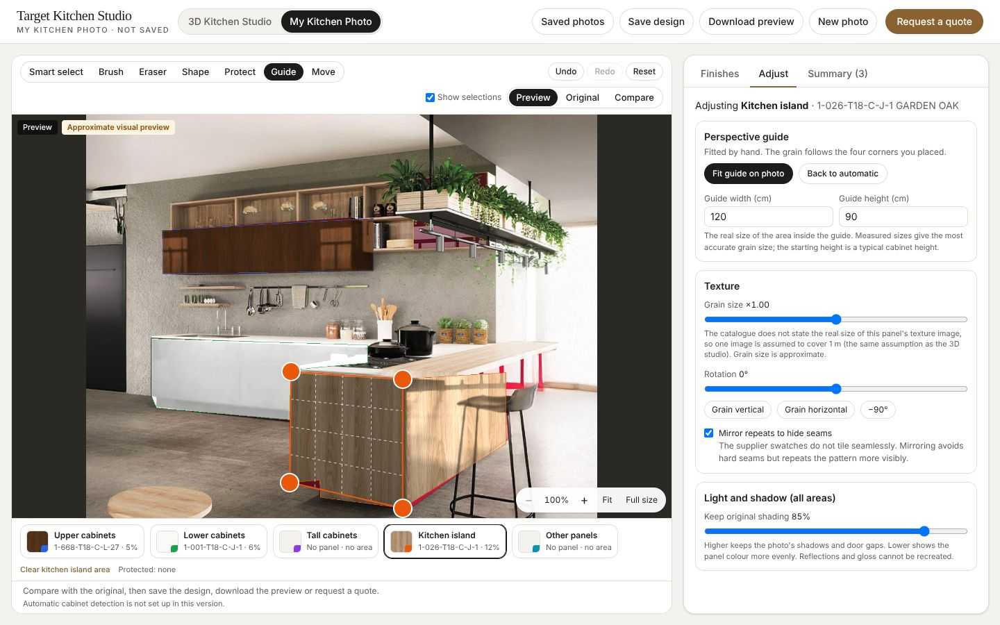
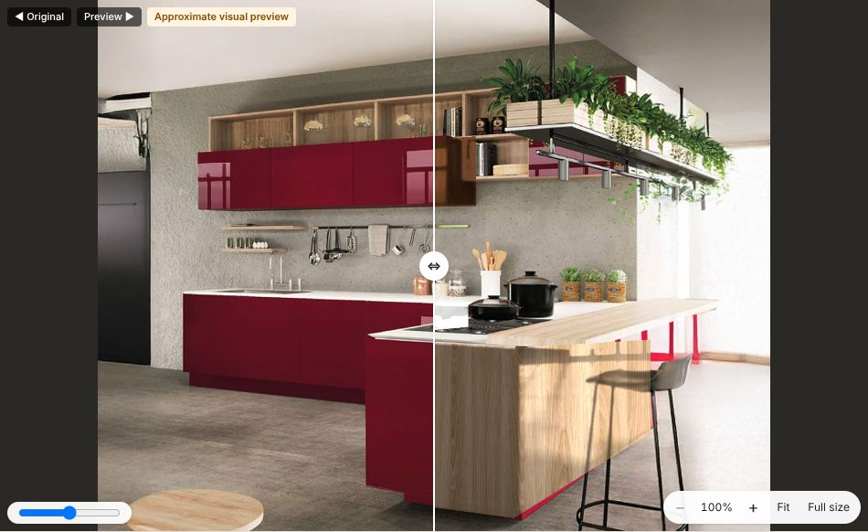

# My Kitchen Photo (photo visualiser)

"My Kitchen Photo" is the second mode of Target Kitchen Studio, next to the 3D configurator. A homeowner or designer uploads a photo of their own kitchen, marks the cabinet surfaces, and previews real catalogue panels on them. Open it with the **My Kitchen Photo** tab in the header, or go to `/?mode=photo`.

The result is an **approximate visual preview**. The UI says so on the image, on the exported file and in the quote.





## How it works for the user

1. **Upload.** Drag a photo onto the page or choose one: JPG, JPEG, PNG or WebP, up to 20 MB. The photo is shown before it is processed, with Remove and Choose another. Phone photos are turned upright using their EXIF orientation. The photo is resized to 1600 px on its long side for editing, which keeps it fast on phones and still sharp on screen.
2. **Mark the cabinets.** Choose an area (Upper cabinets, Lower cabinets, Tall cabinets, Kitchen island, Other panels), then:
   - **Smart select**: click a door. The area of similar colour around the click is selected. The **Colour range** slider controls how far it spreads, and **Add / Remove** decides whether the click adds or removes.
   - **Brush** and **Eraser**: paint by hand, with an adjustable size.
   - **Shape**: click the corners of a door or panel, then close the shape. Best for glossy doors with reflections.
   - **Protect**: paint over worktops, appliances, handles, walls and anything else that must never be recoloured. Protected pixels are removed from every area and blocked from later selections.
   - Each pixel belongs to one area only, so areas never overlap.
   - **Undo / Redo** (also Ctrl+Z / Ctrl+Shift+Z), **Clear area**, and **Reset**, which removes everything and shows the original photo. Reset can be undone.
3. **Choose finishes.** The normal catalogue panel opens (same search, filters, thumbnails and product details as the 3D studio) and the chosen panel is applied to the active area. Each area can have a different panel.
4. **Fit the grain (optional, recommended).** The **Guide** tool shows four corners. Drag them onto the edges of one cabinet face. The texture is then laid out in that face's perspective, so the grain follows the cabinet's verticals and gets smaller with distance. In **Adjust** you can enter the real size of the area inside the guide, change grain size and rotation, mirror repeats to hide seams, and set how much of the photo's shading is kept.
5. **Compare.** Preview, Original, or Compare (a before/after slider). Zoom up to 800% (buttons, Ctrl+scroll, two-finger pinch on phones), Move tool to pan, and Full size for a 1:1 view.
6. **Summary, export, save, quote.** The Summary tab lists the panel code for each area. **Download preview** saves a JPG with a caption giving every panel code by area and the "approximate preview" note. **Save design** keeps it in this browser. **Request a quote** uses the existing quotation form.

## Privacy and what is stored where

| Data | Where | Notes |
| --- | --- | --- |
| Uploaded photo | Only in the browser's memory | Never uploaded. All processing (decoding, resizing, selection, compositing) runs in the browser. |
| Saved photo designs | This browser's IndexedDB (`tks-photo-designs`) | Holds: unique design ID, name, notes, created/updated times, panel codes by area, the selections (masks, compressed), guide and texture settings, the preview image, and the resized photo only if the user ticks "Keep my photo with the design". Nothing is sent to a server. Up to 30 designs. Lost if the browser's site data is cleared. |
| Quote request | Server, same store as 3D enquiries (`DATA_DIR/enquiries.json`, or Supabase) | Contact details, panel codes by area (each checked against the catalogue on the server) and the design name and ID. The photo is **not** sent. |
| Preview image attached to a quote | `DATA_DIR/enquiry-previews/<enquiry id>.jpg` (file mode 600), or the **private** Supabase Storage bucket `enquiry-previews` | Only sent if the customer ticks "Attach my preview image", which explains what it shows. Served only to signed-in admins through `/api/admin/enquiries/<id>/preview` with `Cache-Control: private, no-store`. Never public. |

**Retention.** Attached previews are kept as long as the enquiry. There is no automatic deletion yet. If you need a retention period (for example 12 months), delete old files in `DATA_DIR/enquiry-previews/` or the bucket on a schedule, and mention the period in your privacy notice.

**Setup for production.** Nothing extra is needed on a normal Node.js host with a persistent `DATA_DIR`. On serverless hosts (Netlify, Vercel), set `SUPABASE_URL` and `SUPABASE_SERVICE_ROLE_KEY` and run `supabase/schema.sql`, which now also creates the private `enquiry-previews` bucket. Without a working store, quote requests fail with a clear error and never show success.

## How the preview is made

Code: `src/lib/photo/composite.ts` (pure TypeScript, unit-tested).

- The panel's own texture file from the catalogue (`textureUrl`) is used, or its plain colour (`colourHex`) for plain panels. If a product has neither, or its texture fails to load or is under 64 px, the panel is **not applied**: the user sees a warning and the area keeps its previous finish. No other panel is ever substituted.
- **Perspective:** a homography maps the area's guide quadrilateral to a flat rectangle of the size given in Adjust. Texture coordinates are in metres on that plane, with one texture image covering the product's `textureScale` (Kastamonu does not state it, so 1 m is assumed, the same as in the 3D studio, and the UI says so), times the user's grain-size setting. The rotation is the product's grain direction plus the user's rotation. Until a guide is fitted, an upright box around the selection is used and the hint asks the user to fit it.
- **Shading:** the photo's luminance, lightly blurred so the old finish's own texture does not show through, is divided by its average over the area and multiplied into the new texture in linear light. Shadows, door gaps and light fall-off stay. The strength can be changed.
- **Masks:** edges are softened only on the inside of the selection. Pixels outside every selection are never written, so they stay byte-for-byte identical to the uploaded photo (checked in the unit tests and the browser tests).
- **Seams:** most supplier swatches are 520 × 520 px and not seamless. "Mirror repeats" (on by default) hides the hard seams by mirroring alternate repeats.

## Automatic detection

**Not configured.** No segmentation model is included. The editor says "Automatic cabinet detection is not set up in this version" and the manual tools are fully usable. Smart select is a classic colour-similarity fill (not AI) and is described as such.

Detection is isolated behind `SegmentationService` in `src/lib/photo/segmentation.ts` (`status()` and `segment(image, hints)`). To add one later:

- **Preferred (free, private):** an open model that runs in the browser, such as SlimSAM or MobileSAM through `@huggingface/transformers` (Apache-2.0) on WebGPU/WASM. The photo never leaves the device. It needs a model download of roughly 10 to 40 MB on first use and is slow on older phones. These models segment the object around a clicked point; they do not "know" cabinets, so the user still clicks each door and confirms. Check the model's licence before use.
- **Hosted APIs** (paid per image) would send the customer's photo to a third party. If one is ever used, `status()` must report `sendsPhotoOffDevice: true` and the UI must ask for consent first.
- Register the implementation with `setSegmentationService()`. Until a service reports `available: true`, nothing in the UI claims detection.

## Code map

| Part | Files |
| --- | --- |
| Upload and validation | `src/lib/photo/validation.ts` (type sniffing, size and dimension limits, EXIF orientation), `src/lib/photo/browserImage.ts`, `src/components/photo/PhotoUpload.tsx` |
| Masks and selection tools | `src/lib/photo/mask.ts` (brush, polygon, smart select, run-length storage), `src/components/photo/PhotoCanvas.tsx`, `PhotoToolbar.tsx`, `PhotoRegionBar.tsx` |
| Mask editing rules, undo/redo | `src/lib/photo/state.ts` |
| Perspective | `src/lib/photo/perspective.ts` |
| Texture compositing | `src/lib/photo/composite.ts`, `src/lib/photo/materials.ts` |
| Product selection | existing `src/components/MaterialPanel.tsx` and `/api/catalogue` (no second product list) |
| Design persistence | `src/lib/photo/design.ts`, `src/lib/photo/designStore.ts`, `src/components/photo/PhotoDesignsDialogs.tsx` |
| Export | `src/lib/photo/exportImage.ts` |
| Quotation | `src/components/QuoteDialog.tsx` (photo option), `src/lib/enquiries/schema.ts`, `src/lib/server/enquiries.ts`, `src/lib/server/previewStore.ts`, `src/app/api/admin/enquiries/[id]/preview/route.ts` |
| Mode switch | `src/components/KitchenApp.tsx`, `src/components/ModeTabs.tsx` |

## Tests

```bash
npm test                    # unit tests, including tests/unit/photo.test.ts
npm run build
ADMIN_PASSWORD=some-long-test-password DATA_DIR=/tmp/tks-photo npm start
E2E_DATA_DIR=/tmp/tks-photo ADMIN_PASSWORD=some-long-test-password npm run test:e2e:photo
```

`test:e2e:photo` runs the 14 acceptance checks in Chromium. Without settings it uses a generated test kitchen. To use a real photo, add `PHOTO_FRONT=/path/kitchen.jpg PHOTO_POINTS='{"upper":[[x,y],...],"lower":[[x,y],...],"wall":[x,y],"worktop":[[x,y],[x,y]]}'` (points in the photo's own pixels). Results go to `e2e-photo-screenshots/results.json`. The results from 25 Oct 2026 are in `docs/e2e-photo-results.json`.

Latest results (25 Oct 2026, headless Chromium): **14/14** on a real kitchen photo from the brand PDF and **14/14** on the generated test kitchen, no page errors. Existing suites after this change: real-catalogue 3D checks 8/8, designs/quotes/admin 17/17, unit tests 57/57.

| # | Check | Result (real photo) |
| --- | --- | --- |
| T1 | Upload a valid kitchen photo (JPG, PNG, WebP), preview before processing, privacy note | pass: JPG 1113×1024 for editing; PNG and WebP also open; privacy note shown before processing |
| T2 | Invalid formats, HEIC, fake and oversized files are refused with clear messages; EXIF rotation corrected | pass: pdf, fake jpg, HEIC, 21 MB and 120×90 refused with specific messages; sideways phone photo (EXIF 6) shown upright 800×736 |
| T3 | Select cabinet surfaces manually (smart select, brush, shape) | pass: upper 8.8% (smart select), lower 18.1% (brush + smart), other 0.88% (shape) |
| T4 | Correct mistakes: eraser, remove mode, protect, clear, undo/redo | pass: wall mistake undone/redone and removed; eraser 8.8% → 8.6%; 19648 px protected and excluded |
| T5 | Apply a real Target (Kastamonu) panel texture to the selected surface | pass: 1-668-T18-C-L-27 CANALETTO WALNUT from /brands/kastamonu/textures/1-668.jpg; labelled “Approximate visual preview” |
| T6 | Areas outside the masks are unchanged by compositing | pass: 827026 unselected pixels identical to the photo; 97998 of 312686 selected pixels changed |
| T7 | Different panel codes on different regions; a missing texture is refused, not substituted | pass: upper 1-668-T18-C-L-27, lower 1-001-T18-C-J-1 (plain colour), other 1-026-T18-C-J-1; broken texture 1-525 refused with a warning |
| T8 | Reset restores the original photo (and Undo brings the work back) | pass: screen identical to the uploaded photo after Reset; Undo restored all three regions |
| T9 | Compare original and preview: toggle, slider, zoom, full size | pass: original label, compare slider at 30% clips the original, zoom 156%, full-size view opens |
| T10 | Design summary lists the selected panel codes by region | pass: upper_cabinets: 1-668-T18-C-L-27, lower_cabinets: 1-001-T18-C-J-1, other_panels: 1-026-T18-C-J-1 |
| T11 | Save the design (reopens with the same codes) and submit a quote with an attached preview | pass: saved and reopened “E2E villa photo”; quote ENQ-20261025-9HS4H4; stored with 3 checked codes; 197 KB preview kept privately; 401 without sign-in, 200 for a signed-in admin |
| T12 | Works on a phone (390×844 touch): no sideways scroll, draw with a finger, controls reachable | pass: no horizontal scroll; tap smart-select 6.4%; texture applied; photo area 279px tall |
| T13 | The 3D configurator still works (switch modes, 3D renders, panel applies) | pass: 3D ready, lower cabinets 21 meshes, 1-669 applied in 3D; photo work kept when switching back |
| T14 | No unconfigured AI or backend is reported as working | pass: “Automatic cabinet detection is not set up in this version.” shown; no detection claims; server failure shows an error, never success |

## Known limitations

- It is an approximation. Gloss, reflections and the new panel's own sheen are not simulated; the photo's existing reflections are kept, which can look wrong when switching from gloss to matt.
- One perspective guide per area. An island with two visible faces is best split: one face in "Kitchen island", the other in "Other panels", each with its own guide.
- Curved, profiled or shaker doors are treated as flat.
- Smart select can spread too far on glossy doors, reflections or low-contrast photos. The app warns when one click selects more than 15% of the photo; Undo, Protect, Remove mode and the Shape tool fix it.
- Supplier swatches are low resolution (520 px) and not seamless, so close-up zoom looks soft and repeats can be visible.
- The real-world size of a swatch is not in the catalogue, so grain size is an estimate unless `textureScale` is supplied.
- Photos are edited at 1600 px on the long side; exports are at that size.
- Saved photo designs are per browser and device (no account sync).
- Tested in headless Chromium (desktop and iPhone 13 emulation, with touch). Not yet tested on real iOS Safari, Android Chrome or Firefox devices.
